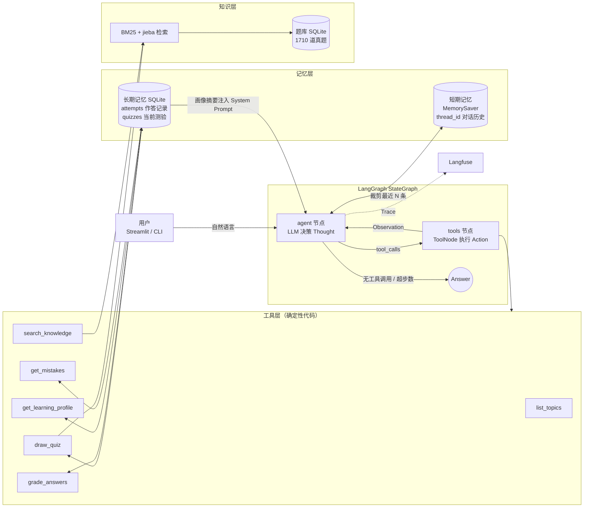

# 智备 Agent 架构设计

## 1. 总体架构

## 2. Agent 循环（ReAct）

| 阶段 | 对应实现 | 说明 |
|---|---|---|
| 感知 | `agent_node` 组装输入 | System Prompt（含长期记忆画像摘要）+ 裁剪后的对话历史 |
| 决策 Thought | `llm_with_tools.invoke` | 通义千问原生 Function Calling，决定是否调用、调用哪些工具、参数是什么 |
| 行动 Action | `ToolNode` | 执行工具；异常被 `handle_tool_errors` 捕获转成 Observation |
| 观察 Observation | `ToolMessage` 回到 agent | 工具返回 JSON，可能包含 `error`/`hint`，LLM 据此自我修正 |
| 回答 Answer | `route()` 判断无 tool_calls | 结束本轮 |
| 防死循环 | `steps > MAX_AGENT_STEPS` | 不再绑定工具，追加 FORCE_FINISH 指令强制收尾；外层还有 `recursion_limit` 兜底 |

## 3. 记忆设计

| 类型 | 存储 | 写入时机 | 读取方式 |
|---|---|---|---|
| 短期（对话上下文） | LangGraph `MemorySaver`，按 `thread_id` | 每轮自动 | `trim_messages` 保留最近 16 条，且从 human 消息开始，保证 tool_call 与 ToolMessage 成对 |
| 长期（学习记录） | SQLite `attempts` | `grade_answers` 判分时 | ① 每轮生成画像摘要注入 System Prompt；② 工具 `get_learning_profile`/`get_mistakes`/`draw_quiz(source=weak/mistakes)` 主动读取 |
| 工作记忆（当前测验） | SQLite `quizzes` | `draw_quiz` | `grade_answers` 根据题号找到对应试题 ID |

## 4. 关键设计决策

1. **LLM 管决策，代码管事实**：抽题、判分、记错题全部是确定性代码；LLM 只负责理解意图、抽参数、讲解。避免"模型自己出题自己判"带来的幻觉。
2. **工具不抛异常**：返回 `{"error","hint"}`，把错误变成 Observation，让 Agent 能重试或换方案。
3. **按用户实例化工具**：`make_tools(user_id)` 闭包绑定用户，多用户记忆互不干扰，LLM 也无需（也无法）伪造 user_id。
4. **检索选 BM25 而非向量库**：题目短、专有名词密集（CANN、MindIE、ZeRO），关键词匹配更准，零 API 成本，可离线；接口与向量检索一致，后续可替换。
5. **可观测性可插拔**：配置了 Langfuse 密钥就自动挂 CallbackHandler，每轮生成 Trace（含每次 LLM 调用、工具调用、耗时、token）。
