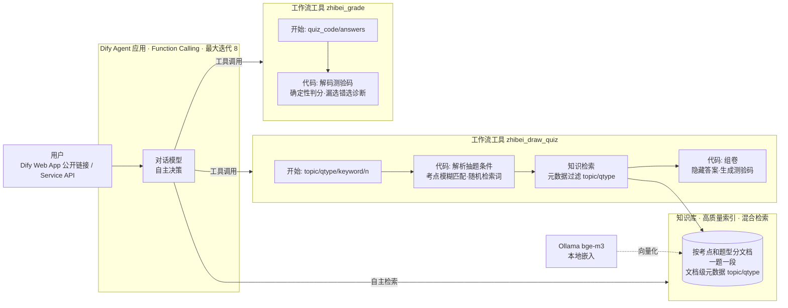

# 智备的 Dify 架构与部署

## 1. 架构



## 2. 关键设计

| 问题 | 设计 |
|---|---|
| Dify 元数据是**文档级**，无法按分段过滤 | 按「考点 × 题型」拆分文档，每个文档带 topic/qtype 元数据；文档内用 `@@@@` 分隔，一题一段 |
| 同一检索语句总返回同一批题 | 抽题前用代码节点从考点关键词池随机挑词组成检索语句，检索 Top10 后再随机抽 n 题 |
| 需要在对话轮次间关联同一组题 | **测验码**把试题 ID、题型与参考答案可逆编码。模型从对话里原样回传，判分工作流解码。 |
| 抽题和判分职责分离 | 抽题结果不直接返回明文答案；判分由代码节点完成。测验码不是安全加密，应用不用于正式考试。 |
| 经济索引（关键词倒排）召回不足，搜 "LoRA" 命中 0 条 | 改为高质量索引：本地 Ollama bge-m3 向量 + 全文混合检索（各 0.5 权重），"LoRA" 命中 10 条相关题 |
| 条件为空时也要能抽题 | 元数据条件用 `contains`，值为空串时匹配全部（已实测） |
| 向量检索没有"查无"信号，"量子力学"会凑进 Keras 题 | 组卷节点做关键词相关性校验（中文二字片段，≥3 片段时需命中 2 个）；无相关题时返回 error，由 Agent 如实告知 |

## 3. 部署（本机 Docker）

前置：按 [Dify 1.20.0 官方发布说明](https://github.com/langgenius/dify/releases/tag/1.20.0) 启动本机 Docker 实例，在 `http://localhost/install` 创建管理员。安装 OpenAI 兼容和 Ollama 模型插件：前者配置支持工具调用的对话模型，后者配置 `bge-m3` 嵌入（Docker Desktop 下可使用 `http://host.docker.internal:11434` 指向宿主机服务）。

将仓库的 `.env.example` 复制为 `.env`，令 `LLM_MODEL` 与 Dify 控制台中的对话模型名称一致。部署脚本使用工作区的默认文本嵌入模型来创建知识库，请在 Dify 控制台中将它设为 `bge-m3`。

如果 Dify 使用自定义端口，在 `.env` 中设置 `DIFY_CONSOLE_BASE` 和 `DIFY_API_BASE`。例如端口为 `18080` 时，分别使用 `http://127.0.0.1:18080/console/api` 和 `http://127.0.0.1:18080/v1`。通过当前 PowerShell 会话设置 `DIFY_ADMIN_EMAIL` 和 `DIFY_ADMIN_PASSWORD` 供脚本登录。模型凭据在 Dify 控制台配置。

先按 README 导入自编样例，或从自己获准使用的资料导入题库。再从仓库根目录依次运行：

```powershell
.\.venv\Scripts\python -m dify.export_kb
```

```powershell
.\.venv\Scripts\python -m dify.setup_kb
```

```powershell
.\.venv\Scripts\python -m dify.setup_apps
```

```powershell
.\.venv\Scripts\python -m dify.setup_agent
```

`setup_agent` 会在本机 `.env` 写入 Dify 应用 API Key，并输出 Web App 地址。默认流程不重置现有知识库。对已有课程环境做配置前先备份；这些脚本会更新应用设置与工作流草稿。

手动部署时也可导入 `dify/templates/` 中的 DSL，把抽题节点重绑到自己的知识库，再将两个工作流「发布为工具」。在经典 Agent 应用里挂载工具和知识库，选 Function Calling 并填写 `dify/agent_prompt.md`。

## 4. 文件清单

| 文件 | 作用 |
|---|---|
| `dify/export_kb.py` | 导出按考点和题型分组的知识库文档和清单 |
| `dify/nodes/draw_prepare.py` `draw_format.py` `grade.py` | 三个代码节点源码（纯标准库，`tests/test_dify_nodes.py` 本地单测） |
| `dify/build_dsl.py` | 生成与本机知识库绑定的 DSL 到 `dify/dsl/`；仓库中的通用模板在 `dify/templates/` |
| `dify/setup_kb.py` `setup_apps.py` `setup_agent.py` | 通过 Dify API 自动化部署 |
| `dify/agent_prompt.md` | Agent 提示词 |
| `eval/cases_dify.json` `eval/run_eval_dify.py` | Dify 版评测（解析 SSE 中的 agent_thought 事件检查工具调用） |
| `eval/results_dify.md` | 实训评测摘要；详细会话和截图留在本机 |

## 5. 已知局限

- **跨会话长期记忆**：Dify Agent 应用的记忆仅限当前会话，错题与薄弱点总结基于本次对话。
- 题库中 CANN 相关题目较少（7 题），这是题库本身的覆盖问题。
- Dify 1.20 将该类应用标为 "Legacy Agent"；新版 Agent（beta，自带沙箱）尚不稳定，本项目选择稳定的经典 Agent。
